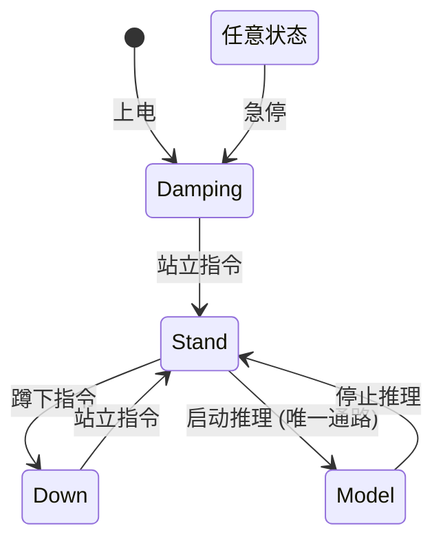

# Go1 有限状态机 (FSM) 控制系统

## 项目概述

基于 Unitree Go1 四足机器人的**C++ 有限状态机 (Finite State Machine, FSM)** 控制系统，用于部署强化学习 (RL) 策略模型（`.pt` / `.onnx`），实现机器人的多模态运动控制。

所有代码放置在 `/home/yxc/WS/go1_fsm/` 下，与现有 `unitree_legged_sdk` 协同工作。

---

## 系统架构

```
┌─────────────────────────────────────────────────────────┐
│                     FSM Controller                       │
│                                                          │
│  ┌──────────┐    ┌──────────┐    ┌──────────┐           │
│  │ Damping  │◄───│  Stand   │───►│   Down   │           │
│  │  急停    │    │  站立    │    │  蹲下    │           │
│  └──────────┘    └────┬─────┘    └──────────┘           │
│       ▲               │                                  │
│       │               │ stand → model (唯一通路)          │
│       │         ┌─────▼──────┐                           │
│       │         │   Model    │  ← 只有 Stand 后才能进入   │
│       │         │  RL 推理   │                           │
│       │         └─────┬──────┘                           │
│       │               │ model → stand                    │
│       │               ▼                                  │
│       └───────────────┘  (任意状态急停 → Damping)         │
│                                                          │
│  ┌──────────────────────────────────────────────┐        │
│  │            Unified Config System              │        │
│  │              统一配置系统 (Header-only)         │        │
│  └──────────────────────────────────────────────┘        │
└─────────────────────────────────────────────────────────┘
         │
         ▼
┌─────────────────────────────────────────────────┐
│        Unitree Go1 SDK (unitree_legged_sdk)       │
│        LowCmd / LowState / UDP / Safety           │
└─────────────────────────────────────────────────┘
```

---

## 四个核心状态

### 1. Stand — 站立状态
- 控制模式：**MIT 模式** (`MotorCmd.mode = 0x0A`)
- 使用**平滑插值** (smooth step) 从当前姿态过渡到目标站立姿态
- PD 控制律: $\tau = K_p(q_{des}-q) + K_d(\dot{q}_{des}-\dot{q}) + \tau_{ff}$
- 可配置：目标位置 `target_q[12]`, `Kp[12]`, `Kd[12]`, `tau_ff[12]`, `transition_time`

### 2. Down — 蹲下状态
- 控制模式：**MIT 模式**
- 同样使用平滑插值过渡
- 可配置：蹲下姿态角度, PD 增益 (较软), 过渡时间

### 3. Damping — 阻尼/急停状态
- 控制模式：**Damping 模式** (`MotorCmd.mode = 0x00`)
- 所有电机进入自由阻尼，不输出主动力矩
- **上电默认进入此状态**，确保安全

### 4. Model — RL 推理状态
- 控制模式：**MIT 模式**
- 加载 `.pt` / `.onnx` 模型进行推理
- **⚠️ 只有从 Stand 状态才能进入 Model**（唯一通路）
- 预留 libtorch / onnxruntime 推理接口

---

## 状态转换规则



**非法转换将被拒绝并打印错误日志。**

---

## 目录结构

```
go1_fsm/
├── README.md
├── CMakeLists.txt                  # CMake 构建
│
├── config/                         # 配置 (Header-only C++ struct)
│   ├── stand_config.h              # StandConfig 结构体
│   ├── down_config.h               # DownConfig 结构体
│   ├── damping_config.h            # DampingConfig 结构体
│   └── model_config.h              # ModelConfig 结构体
│
├── include/go1_fsm/
│   ├── fsm_state.h                 # FSState 数据结构体 (参考 LowState)
│   ├── fsm_controller.h            # FSMController 顶层控制器
│   ├── state_machine.h             # StateMachine 状态机核心
│   └── states/
│       ├── base_state.h            # BaseState 抽象基类
│       ├── stand_state.h           # StandState
│       ├── down_state.h            # DownState
│       ├── damping_state.h         # DampingState
│       └── model_state.h           # ModelState (RL 推理)
│
├── src/
│   ├── fsm_controller.cpp
│   ├── state_machine.cpp
│   └── states/
│       ├── stand_state.cpp
│       ├── down_state.cpp
│       ├── damping_state.cpp
│       └── model_state.cpp
│
├── utils/
│   ├── interpolation.h             # 线性/平滑插值工具
│   └── joint_mapper.h              # 关节名称 ↔ 索引
│
├── example/
│   └── example_fsm.cpp             # 使用示例 (键盘控制)
│
└── models/                         # 放置 .pt / .onnx 模型文件
```

---

## FSState 数据结构体

参考 SDK `LowState` 设计，统一管理机器人状态与控制指令：

```cpp
struct FSState {
    // 反馈 (来自 LowState)
    std::array<float, 12> q, dq, tau_est;  // 关节状态
    std::array<float, 3> rpy, gyro, acc;   // IMU
    std::array<float, 4> foot_force;        // 足端力
    float battery_soc;                      // 电池
    
    // 控制指令 (输出到 LowCmd)
    std::array<float, 12> q_des, dq_des, tau_ff, Kp, Kd;
    uint8_t motor_mode;                     // 0x0A=MIT, 0x00=Damping
    
    uint32_t tick; uint64_t motion_time; float control_dt;
};
```

---

## 插值过渡机制

每个 MIT 模式状态 (Stand/Down) 在 `onEnter` 时记录当前关节角度作为起点，通过 **smooth step** (ease-in-out) 插值平滑过渡到目标姿态：

```cpp
// 平滑插值: rate -> [0,1], 输出 smoothstep(rate)
float smoothStep(float rate) {
    return rate * rate * (3.0f - 2.0f * rate);
}
```

支持线性插值 (`jointLinearInterpolation`) 和平滑插值 (`jointSmoothInterpolation`)，可配置。

---

## 技术要点

| 项目 | 说明 |
|------|------|
| **语言** | C++17 |
| **构建** | CMake |
| **控制频率** | 500 Hz (dt=0.002s) |
| **电机模式** | MIT 模式 `0x0A` (Servo) / Damping `0x00` |
| **通信** | LOW LEVEL (UDP, 与 SDK 一致) |
| **安全** | PositionLimit + PowerProtect (封装 SDK Safety) |
| **实时线程** | 复用 SDK `LoopFunc` (RT priority=95) |
| **模型推理** | 预留 libtorch / onnxruntime C++ API |

---

## 编译 & 运行

```bash
cd go1_fsm
mkdir build && cd build
cmake ..
make -j$(nproc)
./go1_fsm
```

编译产物为**单一二进制文件** `go1_fsm`，可直接拷贝到机器人上执行。

---

## 键盘控制

| 按键 | 功能 |
|------|------|
| `S` | 切换到 Stand (站立) |
| `D` | 切换到 Down (蹲下) |
| `Space` | 急停 → Damping |
| `M` | 启动 RL 推理 (仅 Stand 下有效) |
| `Q` | 退出 |

---

## 待完善事项 (TODO)

- [ ] 确认 Stand / Down 具体目标关节角度 (需实测)
- [ ] 实现 libtorch / onnxruntime 模型加载与推理
- [ ] 确认 RL 模型观测空间、动作空间、归一化参数
- [ ] 考虑手柄/遥控器触发 (复用 SDK wirelessRemote)
- [ ] 日志记录与数据采集
- [ ] ROS/ROS2 接口 (可选)

---

## 依赖

- C++17 (gcc >= 7 / clang >= 5)
- CMake >= 3.10
- `unitree_legged_sdk` (已有)
- Boost (system, bind)
- pthread
- [可选] libtorch (`.pt` 模型推理)
- [可选] onnxruntime (`.onnx` 模型推理)

---

> **状态**: 开发中 | **最后更新**: 2026-07-17
>
> 三状态 (Stand/Down/Damping) 已实现，Model 状态预留推理接口。请审阅并提供补充意见。
